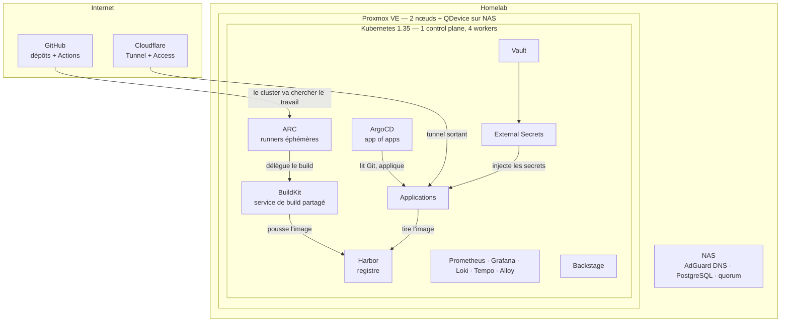

# idp-platform-lab

Une **Internal Developer Platform** complète, construite et exploitée seul sur du matériel d'occasion : de l'hyperviseur jusqu'au portail développeur, en passant par le GitOps, les secrets, l'observabilité et la CI.

L'objectif n'est pas d'empiler des outils, mais de comprendre **comment ils s'articulent** : qui parle à qui, avec quelle identité, et où passent les frontières de confiance.

---

## Pourquoi construire ma propre plateforme

Au quotidien, je travaille sur des clusters managés (AKS). Un service managé est efficace, mais il **cache** une grande partie du système : le control plane, le réseau, le stockage, le DNS, la gestion des certificats. Tant que tout fonctionne, ce n'est pas un problème. Le jour où quelque chose casse, il faut comprendre ce qui se passe en dessous.

Construire la plateforme de bout en bout m'oblige à prendre chaque décision moi-même, et à vivre avec ses conséquences :

- **comprendre chaque couche**, du noyau Linux (namespaces, cgroups) jusqu'au portail Backstage ;
- **diagnostiquer de vraies pannes**, sans support ni console qui le fait à ma place (voir [`docs/frictions.md`](docs/frictions.md)) ;
- **raisonner en ingénieur plateforme** : une plateforme est un produit, ses utilisateurs sont les développeurs, et chaque brique doit pouvoir être livrée, mise à jour et réparée par Git.

## Pourquoi pas Azure ou AWS

Ce n'est pas un rejet du cloud : les outils choisis ici (Kubernetes, ArgoCD, Vault, Helm, Terraform, GitHub Actions) fonctionnent à l'identique sur AKS ou EKS. C'est un choix de terrain d'apprentissage :

| Critère | Cloud public | Ce lab |
|---|---|---|
| **Visibilité** | le control plane et le réseau sont gérés par le fournisseur | chaque couche est installée, configurée et dépannée à la main, puis automatisée |
| **Coût** | facturation continue, qui pousse à tout éteindre ou à tout simplifier | coût fixe : deux mini PC d'occasion et un NAS, une plateforme qui tourne 24 h/24 |
| **Portabilité** | tentation d'utiliser les services propriétaires (Key Vault, ACR, Load Balancer…) | uniquement des briques open source et standards : ce qui marche ici marche partout |
| **Maîtrise des données** | les données sont chez un tiers | tout reste sur le réseau local ; seul le trafic utile sort, via un tunnel |

Autrement dit : apprendre sur une plateforme dont je maîtrise tout me rend plus efficace sur une plateforme managée.

---

## Architecture



Tous les flux entre Internet et le lab sont **sortants** : le tunnel Cloudflare et les runners ARC ouvrent eux-mêmes la connexion. Aucun port n'est ouvert sur la box.

## Les briques

| Couche | Composant |
|---|---|
| Hyperviseur | Proxmox VE : cluster de 2 nœuds + arbitre QDevice sur le NAS |
| Provisionnement | Terraform (provider bpg/proxmox) + templates cloud-init |
| Configuration | Ansible (kubeadm, containerd, réglages DNS) |
| Orchestration | Kubernetes 1.35 : 1 control plane, 4 workers |
| Réseau | Cilium (CNI, Gateway API, LB-IPAM, NetworkPolicies) |
| Exposition | Cloudflare Tunnel + Cloudflare Access |
| DNS interne | AdGuard Home : le trafic interne ne sort pas par Internet |
| GitOps | ArgoCD, en « app of apps » |
| Promotion | Kargo |
| CI | GitHub Actions + Actions Runner Controller + BuildKit |
| Registre | Harbor |
| Secrets | Vault + External Secrets Operator |
| Certificats | cert-manager |
| Portail développeur | Backstage |
| Observabilité | Prometheus, Grafana, Alertmanager, Loki, Alloy, Tempo (OpenTelemetry) |

## Décisions d'architecture

Chaque choix a été fait en comparant des alternatives. Les principaux :

| Décision | Alternative écartée | Raison |
|---|---|---|
| **Runners CI éphémères dans le cluster (ARC)** | une VM runner allumée en permanence | un pod par job, détruit à la fin : rien ne tourne entre deux builds, aucun état ne traîne d'un build à l'autre |
| **Identité GitHub App** pour ARC | un jeton personnel | droits limités aux dépôts choisis, jetons valables une heure, indépendante de mon compte |
| **Service BuildKit partagé (rootless)** | Docker-in-Docker dans chaque runner | les runners restent non privilégiés ; le seul composant à droits élargis est isolé par une NetworkPolicy et partage son cache |
| **Comptes robots Harbor par projet** | un compte administrateur | moindre privilège : un build ne peut pousser que dans son propre projet |
| **Secrets dans Vault, livrés par ESO** | Secrets Kubernetes versionnés ou créés à la main | aucun secret dans Git ; Vault est la source de vérité, ESO adapte le format au consommateur |
| **ArgoCD avec selfHeal** | `kubectl apply` ou `helm upgrade` manuels | Git est la seule vérité : toute modification manuelle est annulée |
| **`prune: false` sur les briques porteuses de CRD ou de données** | prune partout | supprimer une CRD supprime en cascade tous les objets de ce type |
| **La CI ne déploie pas** | un pipeline qui fait `kubectl apply` | la CI construit et commite une nouvelle version ; ArgoCD déploie. La CI n'a aucun accès au cluster |

## Ce qui tourne dessus

Deux applications personnelles servent de cas réels pour la plateforme :

- **Signal** : veille technologique. Collecte d'articles, résumés rédigés par un LLM, stockage PostgreSQL ;
- **Radar** : veille d'offres d'emploi, avec un pré-filtre déterministe puis une qualification par LLM, qui doit citer l'annonce pour justifier une exclusion.

Les deux sont déployées en GitOps depuis leur propre dépôt, avec leurs secrets dans Vault et leurs traces dans Tempo.

## Matériel

La plateforme tourne sur deux mini PC d'occasion et un NAS. Rien n'est spécifique à ces modèles, seuls les ordres de grandeur comptent.

- **Nœud 1** : 8 cœurs / 16 threads, 32 Go de RAM, NVMe 500 Go
- **Nœud 2** : Ryzen 5 3550H (4 cœurs / 8 threads), 32 Go de RAM, NVMe 512 Go
- **NAS** : Synology (DNS interne, PostgreSQL, arbitre de quorum)

## Structure du dépôt

```
.
├── scripts/          # template cloud-init Proxmox, installations
├── terraform/        # provisionnement des VMs
├── platform/         # briques de la plateforme (réseau, monitoring, ARC, BuildKit…)
│   └── argocd/apps/  # une fiche ArgoCD par brique (app of apps)
├── apps/             # applications déployées par ArgoCD
├── catalog/          # entités du catalogue Backstage
├── ETAT-HOMELAB.md   # état détaillé de l'installation
└── docs/
    ├── frictions.md        # pannes rencontrées, diagnostic et correction
    └── reprise-gitops.md   # méthode pour passer une brique existante sous ArgoCD
```

[`docs/frictions.md`](docs/frictions.md) recense les problèmes réellement rencontrés : DNS IPv6 qui contourne le résolveur interne, CRD trop volumineuses pour un apply classique, images poussées vers le mauvais endpoint… avec leur diagnostic. [`docs/reprise-gitops.md`](docs/reprise-gitops.md) décrit la méthode en 7 étapes utilisée pour faire adopter par ArgoCD des briques installées à la main, sans interruption de service.

## Reproduire

1. **Template** : sur chaque nœud Proxmox, `bash scripts/create-template.sh 9000` (9001 sur le second : un template local ne se clone pas vers un autre nœud).
2. **VMs** : `cd terraform && cp terraform.tfvars.example terraform.tfvars`, y placer le token Proxmox, puis `terraform init && terraform apply`.
3. **Cluster** : avec le dépôt [deploiement-cluster-k8s-ubuntu24](https://github.com/hocine699/deploiement-cluster-k8s-ubuntu24), `ansible-playbook playbooks/site.yml`.
4. **Plateforme** : appliquer `platform/argocd/root.yaml`. ArgoCD installe ensuite toutes les briques déclarées dans `platform/argocd/apps/`.

## Conventions

- **Nommage** : `k8s-cp-01` pour le control plane, `k8s-worker-01` et suivants pour les workers.
- **Adressage** : le nom, l'identifiant Proxmox et l'adresse IP se déduisent les uns des autres. En diagnostic, ne pas avoir à consulter un tableau fait gagner du temps.
- **Secrets** : aucun secret n'est versionné. Le `.gitignore` exclut les `*.tfstate`, `*.tfvars` et les clés privées. Les secrets applicatifs vivent dans Vault et sont injectés par External Secrets.

## État et suite

La plateforme est en exploitation continue et évolue. Ce qui est fait, et ce qui reste :

- ✅ Socle Proxmox, Terraform, Ansible, Kubernetes, Cilium
- ✅ GitOps : réseau, certificats, secrets, observabilité complète et applications gérés par ArgoCD
- ✅ CI : runners ARC éphémères, identité GitHub App, robots Harbor via Vault
- ⏳ Build d'images par BuildKit et mise à jour automatique des versions dans Git
- ⏳ Harbor, Kargo, Vault et ArgoCD eux-mêmes sous GitOps
- ⏳ Garde-fous avec Kyverno ; golden paths Backstage pour créer une application en self-service
- ⏳ Alerting vers mobile ; mTLS entre runners et BuildKit

**Limites connues**, assumées dans un lab : state Terraform local, NetworkPolicies encore partielles, volumes de données sur stockage local, un seul control plane.

---

Le dépôt est documenté pour être reproductible sur du matériel personnel. Il sert aussi de support à une formation que je prépare sur le platform engineering.

## Licence

MIT

